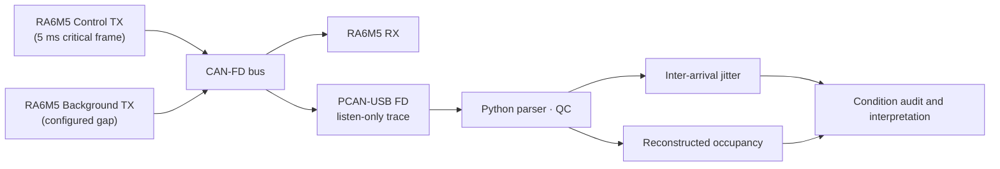

# CAN-FD Signal Packing and Inter-Arrival Jitter of Periodic Frames

[한국어](README.md) | [English](README.en.md)

> An undergraduate research project (URP) that compared how sending the same periodic signals in different CAN-FD frame organizations affects the **inter-arrival jitter of a periodic control frame**. I handled **Python trace parsing, quality checks, and statistics, the audit of comparison conditions, discussion of the re-measurement design, and interpretation**. The work was **submitted** as a full paper to the KSAE 2026 Annual Autumn Conference, where I am a co-author.

| Item | Details |
|---|---|
| Period | Summer 2026 URP (hardware measurements ended Aug 2026; paper submitted Sep 2026) |
| Setup | Three Renesas RA6M5 nodes (control TX / independent background TX / RX), CAN-FD 500 kbit/s nominal · 2 Mbit/s data (BRS), PCAN-USB FD listen-only trace |
| Primary metric | Standard deviation of inter-arrival intervals of a 5 ms critical frame |
| My role | Trace parsing, QC, statistics, comparison-condition audit, results and figures (with the co-authors) |
| Disclosure | Research question, method, direction of the conclusion, and limits only. Raw traces, firmware, and numerical tables or plots are joint research material and remain private |

## 1. Research Question

In vehicle networks, how signals are packed into CAN-FD frames can affect bandwidth and timing. We measured on real boards **whether sending the same signal set distributed (A), grouped per period (B), or fully packed (C) changes the regularity of a periodic control frame's arrivals**.

## 2. Progress and Conclusion

1. **Initial comparison** — under conditions with similar mean bus occupancy, two strategies showed a visible jitter difference.
2. **Condition audit** — re-checking the configuration showed that matching occupancy had also **changed the background-traffic generation gap per strategy**. Packing and the temporal structure of background traffic had changed together, so the difference could not be attributed to packing.
3. **Re-measurement** — with identical background input for all strategies, the large initial difference did not reproduce reliably.
4. **Gap sweep and repeat checks** — sweeping the background generation gap in small steps changed jitter strongly even when reconstructed occupancy was nearly the same. Selected conditions kept the same pattern after board resets and permuted measurement order (performed for one strategy).
5. **Conclusion** — not that one packing strategy always wins, but a validation-method finding: **mean bus occupancy alone does not establish equivalent timing conditions; the temporal structure of background traffic must be controlled or reported**. Packing still has a bandwidth trade-off.

## 3. System Structure



## 4. My Contribution

- Computed metrics only after QC that checks the actual ID, DLC, payload, timestamp, and bit rate in each trace, rather than trusting file names or the plan.
- Compared what was and was not the same between the two conditions and found the confounded comparison in which the background generation gap had also changed.
- Organized the re-measurement and sweep results and narrowed the conclusion by separating what was measured from what was not.
- Board firmware, wiring, and experiment operation were joint team work; joint code and results are not presented as my sole work.

## 5. Measurement Scope and Limits

1. The metric is **inter-arrival jitter**, not one-way latency or WCRT.
2. **Reconstructed occupancy** is computed from frame lengths and bit rates in the trace, not a bus load measured directly by an instrument.
3. The background configured gap is a firmware input, not a release period measured on the wire.
4. The exact cause of the jitter changes (phase relationship, arbitration blocking, etc.) is **not established**. Confirming it requires recording generation requests, actual transmit starts, and receptions on one time axis.
5. Motor stability, real PWM edges, and closed-loop control performance are out of scope.
6. The earlier version of this README (Jul 2026) described an early campaign in which the same TX node also sent dummy traffic. The final conclusion is based on the setup above with an independent background TX node.

## 6. Paper

J. Shin, **Y. H. Choi**, H. Kwak, M. Koo, and J. Jeon, "Analysis of Inter-Arrival Jitter in Periodic Control Frames under Different Temporal Structures of Background Traffic in CAN-FD," full paper (8 pp., in Korean), KSAE 2026 Annual Autumn Conference, **submitted Sep 2026**. Acceptance and presentation are not yet confirmed.

## 7. Contents

```text
.
├─ README.md      # Korean
└─ README.en.md   # English
```

Raw TRC files, firmware, FSP-generated code, analysis source, numerical tables or plots, and the manuscript PDF are not included.
