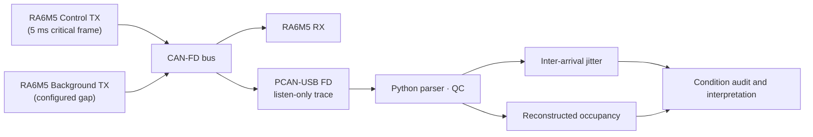

# CAN-FD 신호 패킹과 주기 프레임 도착 간격 지터 연구

[한국어](README.md) | [English](README.en.md)

> 같은 주기 신호들을 서로 다른 CAN-FD 프레임 구성으로 보냈을 때 **주기 제어 프레임의 도착 간격 지터(inter-arrival jitter)**가 어떻게 달라지는지 비교한 학부연구(URP)입니다. 저는 **Python trace 파싱·품질 점검·통계 분석, 비교 조건 감사, 재측정 설계 논의와 결과 해석**을 맡았습니다. 결과는 2026 한국자동차공학회 추계학술대회 Full Paper로 **제출(Submitted)**했으며 저는 공동저자입니다.

| 항목 | 내용 |
|---|---|
| 기간 | 2026년 여름 URP (하드웨어 측정 2026-08 종료, 논문 제출 2026-09) |
| 실험 구성 | Renesas RA6M5 3-node(Control TX / 독립 Background TX / RX), CAN-FD nominal 500 kbit/s · data 2 Mbit/s(BRS), PCAN-USB FD listen-only trace |
| 핵심 지표 | 5 ms 주기 critical frame의 도착 간격 표준편차(inter-arrival jitter) |
| 내 역할 | trace 파싱·QC·통계, 비교 조건 감사, 결과·그림 정리(공동저자들과 함께) |
| 공개 범위 | 연구 질문·방법·결론의 방향과 한계만 공개. 원본 trace, firmware, 수치 표·그래프는 공동연구 자료로 비공개 |

## 1. 연구 질문

차량 네트워크에서는 여러 신호를 몇 개의 CAN-FD 프레임으로 묶을지(packing)가 대역폭과 타이밍에 영향을 줄 수 있습니다. 이 연구는 **같은 신호 집합을 분산(A), 주기별 묶음(B), 완전 묶음(C)으로 보낼 때 주기 제어 프레임의 도착 간격 규칙성이 달라지는가**를 실제 보드로 측정했습니다.

## 2. 진행과 결론

1. **초기 비교** — 평균 버스 점유율을 비슷하게 맞춘 조건에서 두 전략 사이에 눈에 띄는 지터 차이가 보였습니다.
2. **조건 감사** — 설정을 다시 대조해 보니, 점유율을 맞추는 과정에서 **배경 트래픽의 생성 간격도 전략마다 달라져** 있었습니다. 패킹 방식과 배경 트래픽 시간 구조가 함께 바뀐 비교였기 때문에 패킹 효과로 결론 낼 수 없었습니다.
3. **재측정** — 세 전략에 같은 배경 트래픽 입력을 주자 초기의 큰 차이는 안정적으로 재현되지 않았습니다.
4. **간격 sweep과 반복 검증** — 배경 생성 간격을 촘촘히 바꾸자, 재구성 점유율이 거의 같아도 지터는 크게 달라졌습니다. 일부 조건은 보드 리셋과 측정 순서 변경 후에도 같은 패턴을 보였습니다(한 전략에 대해 수행).
5. **결론** — 특정 패킹 전략이 항상 낫다는 결과가 아니라, **평균 버스 점유율만으로 타이밍 조건이 같다고 볼 수 없으며 배경 트래픽의 시간 구조를 통제하거나 보고해야 한다**는 검증 방법론의 결론으로 좁혀졌습니다. 패킹은 대역폭 측면의 trade-off가 여전히 있습니다.

## 3. 시스템 구조



## 4. My Contribution

- trace에서 실제 ID·DLC·payload·timestamp·bitrate를 확인하는 QC를 거친 뒤 지표를 계산했습니다(파일명이나 계획표만 믿지 않음).
- 비교하려는 두 조건이 무엇이 같고 무엇이 다른지 대조해, 배경 트래픽 생성 간격이 함께 바뀐 교란 비교를 찾았습니다.
- 재측정·sweep 결과를 정리하고, 측정한 것과 측정하지 않은 것을 구분해 결론의 범위를 좁혔습니다.
- 보드 firmware와 배선, 실험 운영은 팀 공동 작업이며, 공동 연구 코드와 결과물을 단독 작성물로 표현하지 않습니다.

## 5. 측정 범위와 한계

1. 측정값은 **도착 간격 지터**이며 송신→수신 one-way latency나 WCRT가 아닙니다.
2. **재구성 점유율**은 trace의 프레임 길이·bitrate로 계산한 값이며 계측기가 직접 측정한 bus load가 아닙니다.
3. 배경 트래픽의 configured gap은 firmware 입력값이며 버스 위에서 측정한 실제 송신 주기가 아닙니다.
4. 지터 변화의 정확한 원인(위상 관계·중재 지연 등)은 **입증하지 않았습니다**. 이를 확인하려면 생성 요청·실제 송신 시작·수신을 같은 시간축에서 기록해야 합니다.
5. 모터 안정성, 실제 PWM edge, 폐루프 제어 성능은 다루지 않았습니다.
6. 2026-07에 작성한 이전 버전은 같은 TX 노드가 dummy traffic을 함께 보내던 초기 캠페인을 설명했습니다. 최종 결론은 독립 Background TX 노드를 둔 위 구성 기준입니다.

## 6. 논문

신재호 · **최용훈** · 곽효건 · 구민수 · 전재욱, 「CAN-FD 환경에서 배경 트래픽 시간 구조에 따른 주기 제어 프레임 도착 간격 지터 분석」, 2026 한국자동차공학회 추계학술대회 Full Paper(8쪽), **제출(Submitted, 2026-09)**. 게재·발표 여부는 확정되지 않았습니다.

## 7. 파일 구성

```text
.
├─ README.md      # 한국어
└─ README.en.md   # English
```

원본 TRC, firmware, FSP 생성 코드, 분석 source, 수치 표·그래프와 원고 PDF는 포함하지 않습니다.
